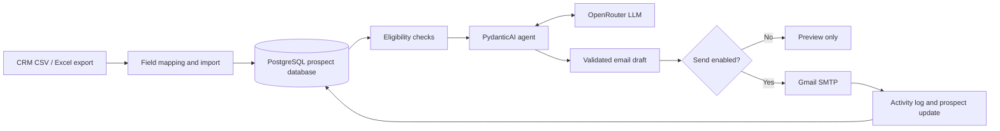

# AI Outreach Agent

**CRM-agnostic AI-assisted email outreach, powered by PydanticAI, OpenRouter, and PostgreSQL.**

The AI Outreach Agent reads eligible prospect records from a PostgreSQL database, uses a language model to draft personalized English emails, shows a preview for review, and optionally sends them through Gmail SMTP.

Prospect data can come from **any CRM export (CSV or Excel)**, including HubSpot, Salesforce, Pipedrive, Zoho, or a custom CRM, **provided its fields are mapped to the common prospect schema and imported into PostgreSQL first**. The agent is not tied to a specific CRM application or dashboard.


## What it does

1. **Read contacts:** Query prospect records imported from CRM exports.
2. **Check eligibility:** Select prospects with status `new`, a valid email field, and no previous AI outreach activity.
3. **Generate an email:** Send only relevant, bounded prospect context to PydanticAI and OpenRouter.
4. **Validate and preview:** Validate the generated `subject` and `body` using Pydantic before delivery.
5. **Send on request:** Deliver through Gmail SMTP only when the operator uses `--send`.
6. **Keep an audit trail:** After a successful send, create an activity marked `[AI_OUTREACH]` and update the prospect status to `contacted`.

## Architecture



> **Import boundary:** The outreach CLI reads database records; it does not directly open arbitrary CRM files. Exports from different CRMs need an import or ETL step that normalizes column names and loads contacts into the database. This step may be implemented using SQL, Python, or an existing importer.

## CRM export compatibility

The source CRM is interchangeable. What matters is the available **prospect information**, not the name of the CRM.

| Canonical field | Example export column names | Required? |
| --- | --- | --- |
| `email` | `Email`, `Contact Email`, `email_address` | **Yes** |
| `name` | `Full Name`, `Contact Name`, `First Name` + `Last Name` | Recommended |
| `company_name` | `Company`, `Account Name`, `Organization` | Recommended |
| `job_title` | `Title`, `Position`, `Role` | Optional |
| `industry` | `Industry`, `Sector` | Optional |
| `company_size` | `Employees`, `Company Size` | Optional |
| `location` | `Country`, `City`, `Region` | Optional |
| `website` | `Website`, `Company Domain` | Optional |
| `linkedin_url` | `LinkedIn URL`, `Profile URL` | Optional |
| `notes` | `Description`, `Notes`, `Pain Points` | Optional |
| `source_crm` | `CRM`, `Source` | Optional |
| `external_id` | `Record ID`, `Contact ID`, `Lead ID` | Optional |
| `status` | `Status`, `Lead Status` | **Yes after normalization** |

For imported records without an equivalent CRM status, your import process may assign `new` **only to contacts you have intentionally approved for outreach**. Do not treat every contact in a CRM export as automatically eligible.

### Example normalized record

```json
{
  "name": "Taylor Morgan",
  "email": "taylor@example.com",
  "job_title": "Head of Operations",
  "company_name": "Example Studio",
  "industry": "Marketing Services",
  "company_size": "11-50",
  "location": "United States",
  "website": "https://example.com",
  "notes": "Interested in improving internal reporting workflows.",
  "source_crm": "CSV import",
  "external_id": "contact-001",
  "status": "new"
}
```

The record is fictitious and for illustration only.

## Database schema

The following is a **reference PostgreSQL schema** for a standalone deployment. Adapt field and table names to your actual models or migrations if your application already has a database schema.

```sql
CREATE TABLE prospects (
    id BIGSERIAL PRIMARY KEY,
    name TEXT,
    email TEXT NOT NULL,
    job_title TEXT,
    company_name TEXT,
    industry TEXT,
    company_size TEXT,
    location TEXT,
    website TEXT,
    linkedin_url TEXT,
    notes TEXT,
    source_crm TEXT,
    external_id TEXT,
    status TEXT NOT NULL DEFAULT 'new',
    created_at TIMESTAMPTZ NOT NULL DEFAULT NOW(),
    updated_at TIMESTAMPTZ NOT NULL DEFAULT NOW()
);

CREATE TABLE activities (
    id BIGSERIAL PRIMARY KEY,
    prospect_id BIGINT NOT NULL REFERENCES prospects(id),
    type TEXT NOT NULL,
    notes TEXT,
    occurred_at TIMESTAMPTZ NOT NULL DEFAULT NOW()
);

CREATE INDEX idx_prospects_status ON prospects(status);
CREATE INDEX idx_activities_prospect_id ON activities(prospect_id);
```

**Relationship:** `prospects.id` (1) → (many) `activities.prospect_id`.

- `prospects` stores normalized contact and company context from CRM exports.
- `activities` stores outreach history and the `[AI_OUTREACH]` marker used to avoid repeated sends.
- In a production importer, add a source-aware unique constraint or upsert rule on `(source_crm, external_id)` where appropriate, and a documented email-level deduplication policy.

## Why PydanticAI

PydanticAI provides typed agent outputs, Pydantic validation, and an OpenRouter integration. The outreach workflow targets Python 3.14 and uses structured output to validate `subject` and `body` before either field reaches the email-sending step.

## Safety and delivery controls

- The language model **does not receive Gmail credentials**.
- The model **does not get database access** and **does not choose recipients**.
- Python queries eligible records and passes only bounded, relevant prospect context to the model.
- CRM content is treated as untrusted input, not instructions.
- The CLI is **dry-run by default**. Sending requires `--send`.
- Actual sends are limited by `OUTREACH_DAILY_LIMIT`.
- A successful send creates an activity with the `[AI_OUTREACH]` prefix and changes the prospect status from `new` to `contacted`.

**Important:** The activity check reduces accidental repeat outreach but is not a transactional guarantee against concurrent duplicate sends. Production workflows should use locking or idempotency controls. Follow applicable privacy, consent, opt-out, and anti-spam rules.

## Setup (macOS / Python 3.14)

Activate your virtual environment:

```bash
python -m venv .venv
source .venv/bin/activate
python --version
```

Install the project with its AI dependencies (if the repository defines the `ai` optional dependency group):

```bash
python -m pip install -e ".[ai]"
```

Alternatively, if the repository includes the requirements file:

```bash
python -m pip install -e .
python -m pip install -r ai_outreach/requirements.txt
```

Copy the environment template:

```bash
cp .env.agent.example .env.agent
```

Configure your **PostgreSQL connection** and import the normalized prospect records. Set your **OpenRouter** credentials and model in `.env.agent`:

```env
OPENROUTER_API_KEY=your-openrouter-api-key
OPENROUTER_MODEL=your-supported-model-slug
```

Also configure the Gmail SMTP sender and a dedicated Google App Password using the environment variable names defined in `.env.agent.example`. Never commit credentials or use your normal Google account password. For a public deployment, prefer Gmail OAuth/API over an app password.

## Run

Preview one prospect (no email sent):

```bash
python -m ai_outreach --limit 1
```

Preview five:

```bash
python -m ai_outreach --limit 5
```

Send emails, subject to `OUTREACH_DAILY_LIMIT`:

```bash
python -m ai_outreach --limit 15 --send
```

Target one database prospect:

```bash
python -m ai_outreach --prospect-id 42
python -m ai_outreach --prospect-id 42 --send
```

## Email generation rules

The agent is instructed to:

- Write natural, professional English.
- Avoid em dashes, emojis, hype, false urgency, and generic AI-sounding language.
- Never invent company facts, business problems, or personal familiarity.
- Use only verified information included in the prospect context.
- Keep the email concise and relevant.
- Finish with a simple, low-friction call to action.

## Tech stack

**Python 3.14 · PydanticAI · OpenRouter · PostgreSQL · Pydantic · Gmail SMTP**

## Scope

This repository demonstrates the **outreach agent workflow**. Importing each CRM's proprietary export format, continuously syncing CRM APIs, generating opt-out lists, and operating a production-grade email infrastructure are separate responsibilities unless explicitly implemented in the codebase.
